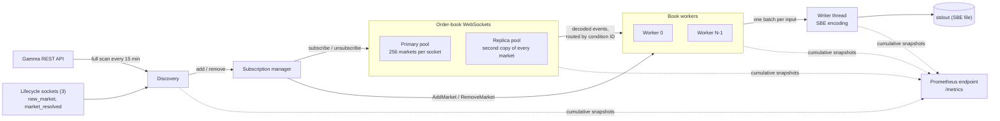

# Architecture

How the collector works. [Design decisions](DESIGN_DECISIONS.md) explains why
it is built this way, [metrics](METRICS.md) covers monitoring, and
[future improvements](FUTURE_IMPROVEMENTS.md) lists what is not built yet.

## Overview



Every market is subscribed twice, once in each socket pool. Its worker keeps
a separate book for each copy and publishes one. When the publishing socket
fails, the worker switches to the other copy.

## Components

| Component | Runs as | Owns |
|---|---|---|
| Discovery | Tokio task | The desired market set. Merges lifecycle events with full Gamma scans. |
| Lifecycle sockets | 3 Tokio tasks | Announcements of new and resolved markets. No book data. |
| Subscription manager | Tokio task | Which two sockets carry each market. |
| Connection tasks | One Tokio task per socket | The socket, its subscription list, heartbeats, reconnects, and decoding. No book state. |
| Book workers | N Tokio tasks (default: available CPUs) | Every book of the markets routed to them, and their snapshot timers. |
| Writer | Dedicated OS thread | stdout. Encodes every record with the supplied SBE helpers. |
| Metrics | Tokio tasks | The cached Prometheus response and the HTTP listener. |

Ownership rules:

- A market belongs to one worker for the life of the process. Only that worker
  reads or changes its books.
- A message goes to worker `low_64_bits(condition_id) mod N`. Both outcome
  books share a condition ID, so they land on the same worker. Nothing about
  routing is stored, and every component uses the same function.
- Only the writer touches stdout. Connection tasks never hold book state.
- There is no task or thread per market or per book.

## Data flow

1. A connection task reads a frame and records its receive time (UTC and a
   monotonic instant) before parsing.
2. It decodes `book` and `price_change` messages into typed events with exact
   fixed-point prices, tags them with its connection ID, and sends each event
   to the market's worker.
3. The worker applies the event to that connection's copy of the book. If the
   connection is the market's publisher, it produces output records.
4. The worker sends all records from one input as a single batch to the
   writer, immediately.
5. The writer converts each record to the supplied SBE types, encodes it into
   a 64 MiB chunk, and writes the chunk to stdout when it fills.

## Output

### Records

| Situation | Written |
|---|---|
| A `price_change` from the publisher | One `PriceLevelUpdate` per subscribed entry, in message order. |
| First publication of a market | A `Snapshot` of each outcome. |
| Every 60 seconds, per published book | A `Snapshot`. |
| A repeat full `book` from the publisher | One `PriceLevelUpdate` per level that differs from the held book; usually none. |
| Publisher switch, or resuming after both copies failed | A full replacement `Snapshot` of each outcome from the new source. |
| Market removal | An empty `Snapshot` for each previously published book. |

Updates from the standby copy never produce output. A quantity of 0 removes a
level; all quantities are absolute. Bids are `Side::Buy`, asks `Side::Sell`.
Snapshot levels are written best first.

### Ordering

Records for one book are written in the order its events were applied, and a
periodic snapshot sits exactly between the events before and after it. This
holds because a book lives on one worker and every channel is FIFO. There is
no ordering across books, and the exchange provides none either.

### Timestamps

| Field | Value |
|---|---|
| `exchange_timestamp` | The source message's timestamp, milliseconds converted to microseconds. |
| `PriceLevelUpdate.backtest_timestamp` | When the connection received the frame, before parsing. |
| `Snapshot.received_at` | The receive time of the latest message applied to that book. |

A quiet book's periodic snapshot keeps its previous timestamps. Receive times
can tie or go backwards across sockets, especially at a switch, so readers
should replay each book in file order rather than sorting by time. See
[the design decision](DESIGN_DECISIONS.md#timestamps-use-receive-time).

### Writer

The writer uses `AlignedSbeWriter` with 64 MiB chunks, because the supplied
reader reads 64 MiB chunks. Output therefore appears in 64 MiB steps, plus a
final flush at shutdown. A crash can lose the chunk in memory and anything
still queued. There is no fsync. Redirect stdout to a regular file; the
supplied reader cannot read a pipe.

## Book maintenance

Each worker keeps two books per outcome, one per source connection. A source
becomes ready once it has received a full `book` for both outcomes in its
current session; an empty book counts.

| Input | Source not synced | Source synced |
|---|---|---|
| Full `book` | Accept as a fresh baseline. | Reject if older than depth already applied; otherwise compare with the held book. |
| `price_change` | Ignore. | Apply in arrival order. |
| Connection reset | Stay not synced. | Become not synced, keeping levels. |
| Snapshot timer | Skip, rearm for 60 s. | Write a `Snapshot` if this source publishes, rearm for 60 s. |

Rules that matter for correctness:

- **Full books are input.** Polymarket resends full books unprompted, up to
  hundreds a minute on busy markets. The worker compares each one with its
  book and writes only differences. A difference on an already synchronized
  source counts as a mismatch: observed divergence, not proof of a lost
  update.
- **Older full books are rejected.** While synced, a full book older than the
  newest depth already applied to that outcome would roll the book back, so
  it is skipped without changing anything. Equal or newer books are accepted.
  A new baseline after a reconnect starts a fresh comparison.
- **Snapshot timers** fire every 60 seconds from first publication. The next
  deadline is 60 seconds after the previous one, so the cadence does not
  drift. Expired timers are handled before queued input, so a busy market
  cannot starve snapshots. Switch snapshots are extra and do not reset the
  timer.
- **Prices are parsed exactly** from decimal strings into fixed point
  (1,000,000 = 1). More than six decimal places is an error. Floats are never
  used.
- **Removal** writes an empty snapshot for each published book, so readers
  clear it, then drops the market. Late data for it is ignored.

## Connections

### Pools and placement

Each market has one copy in the primary pool and one in the replica pool,
with 256 markets (512 outcome assets) per socket. A 250,000-market catalog
needs 977 sockets per pool, 1,954 in total. Primary sockets fill in order.
Replica copies go to the least-loaded replica socket, so the markets on one
busy primary socket fail over to many different sockets. Assignments never
move once made, and connection opens are rate-limited.

When a market is added, the manager registers both source connections with
the worker first, then asks the sockets to subscribe. When it is removed, the
worker is told first, then the sockets unsubscribe. Controls and data share
the worker's channel, so a control always arrives before data it governs.

### Health and reconnect

- Every socket sends `PING` every 10 seconds, busy or idle.
- A remote close, an I/O error, a decode error, or 30 seconds without any
  frame ends the session.
- The connection task first sends a reset (`MarkUnsynced`, with the cause) to
  every worker on the same channel as its data, then reconnects itself:
  immediately, then after 1, 5, 10, and 30 seconds. A session lasting over
  60 seconds resets the schedule. It resubscribes everything on reconnect.
- Because each connection is the only sender of its data and its reset, a
  worker always sees every pre-reset message before the reset and every
  post-reset message after it. No session numbers are needed.

### Missing first books

Some subscribed outcomes never receive their initial `book`. Each outcome
gets five seconds. If it is still missing, the socket sends `unsubscribe`,
waits five seconds, then `subscribe` (resubscribing alone returns nothing),
up to ten times. After a round, it waits 60 seconds and starts another.
Markets that stay incomplete are checked against Gamma; only those reported
ineligible are removed. None of this blocks reads or heartbeats for other
markets on the socket.

## Failover (Extension 1)

A source can take over only when both of its outcome books are ready and it
has seen no failure since. The two feeds are never compared, merged, or
deduplicated, because their timestamps and hashes are not unique.

When the publishing connection fails, each affected market switches in one
worker step:

1. Stop output from the failed source for this market.
2. Write a full replacement `Snapshot` of each outcome from the ready peer.
3. Make the peer the publisher; its later updates apply on top of that
   snapshot.

The failed socket reconnects and rebuilds its books as the new standby. It
never takes publishing back; there is no automatic failback. If a standby
fails, nothing visible happens. If both copies fail, the market stops
publishing until one is ready again, then resumes with replacement snapshots.
A replacement restores the new source's state; it does not reconstruct
updates missed during the failure.

## Discovery

A market is collected when Gamma reports:

```
active && !closed && !archived && acceptingOrders == true
&& two distinct outcome asset IDs && protocol v1
```

Two inputs change the desired set:

- **Lifecycle sockets.** Three sockets subscribe with no assets and receive
  `new_market` for the whole exchange. Each announcement is checked against
  Gamma in batches of up to 100 before admission. `market_resolved` removes a
  market immediately when it arrives.
- **Full scan.** A keyset walk of all open v1 markets, about 2,500 pages,
  runs at startup, every 15 minutes, and after an interval in which no
  lifecycle socket was connected. Pages are buffered, and the result applies
  only if the scan completes. Recent lifecycle events are layered on top, so
  an older page cannot undo them. Markets absent from a complete scan are
  removed; a failed scan changes nothing.

At startup, lifecycle sockets and the first scan start together. Markets
known only from the scan begin collection when it finishes.

Limits: a market missed by every lifecycle socket waits for the next scan,
and one that opens and closes between scans can be missed entirely. A market
that has stopped trading but still reports `acceptingOrders=true` stays
subscribed.

## Backpressure, failure, and shutdown

All queues are bounded. A full writer channel blocks workers, full worker
channels stop connection tasks from reading, and the exchange may then close
a slow socket (`1013`), which takes the normal reconnect path. Updates are
never silently dropped while a book is published.

The collector exits nonzero if a stdout write fails, a worker panics, or the
writer channel stays full for 30 seconds.

On SIGINT or SIGTERM:

1. Readiness turns off. Discovery and the subscription manager stop.
2. Sockets stop reading, finish forwarding what they received, and close.
3. Workers drain their input; the writer drains, flushes, and closes the file.
4. Final metrics are published, then the HTTP listener closes. Exit 0.

A second signal, or a 10-second total deadline, forces a nonzero exit.

## Challenge extensions

| Extension | Status |
|---|---|
| 1. Redundant WebSockets | Implemented, as described under [Failover](#failover-extension-1). |
| 2. Subscription monitoring | Deliberately not built; see below. |
| 3. Exchange-generic | Implemented through the `BookProtocol` trait; see below. |
| 4. Latency | `TCP_NODELAY` on every socket ([decision](DESIGN_DECISIONS.md#tcp_nodelay-on-every-websocket-extension-4)), plus [documented experiments](FUTURE_IMPROVEMENTS.md#latency-extension-4). |

### Why subscription monitoring was not built

We replayed every per-market capture we had against a proposed rule
(resubscribe when a market's two-minute update rate drops). It never
triggered; the lowest two-minute rate was 57% of a market's average, and the
only deeper dips were whole-socket blackouts that the 30-second silence rule
already handles. The book mismatches in longer runs were small differences
on busy markets that kept updating, traced to exchange sequencing, not
markets going quiet. The subscription failure we did see, first books that
never arrive, is handled by the missing-book retries; a rate rule cannot
detect a market with no data.

Building it would also have mixed resubscriptions and switches into the
failures we were still investigating, and real quiet periods look identical
to stalls, causing churn. Revisit if a capture shows a market going quiet
while its socket stays healthy. Our longest per-market capture was five
minutes, so long-term subscription reliability is not established.

### Exchange-generic boundary

The shared connection loop owns reconnects, pacing, receive timestamps,
subscription state, first-book retries, and ordered delivery of data and
resets. Each exchange implements `BookProtocol`, which supplies connection
requests, subscription messages, heartbeats, and frame decoding, and can
report sequence gaps. Workers accept absolute and relative quantity changes
for two-outcome markets. Polymarket is the only production adapter; a
sequence-numbered binary test protocol verifies the boundary, but this does
not claim real Kalshi support.
